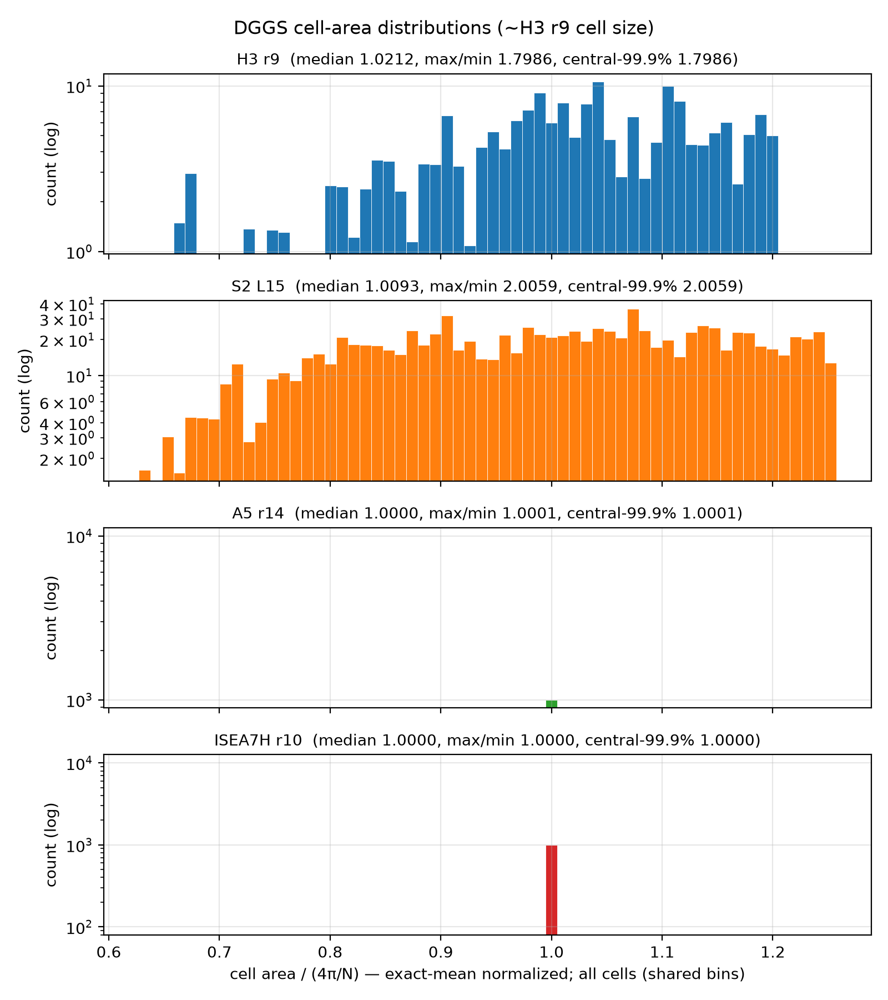
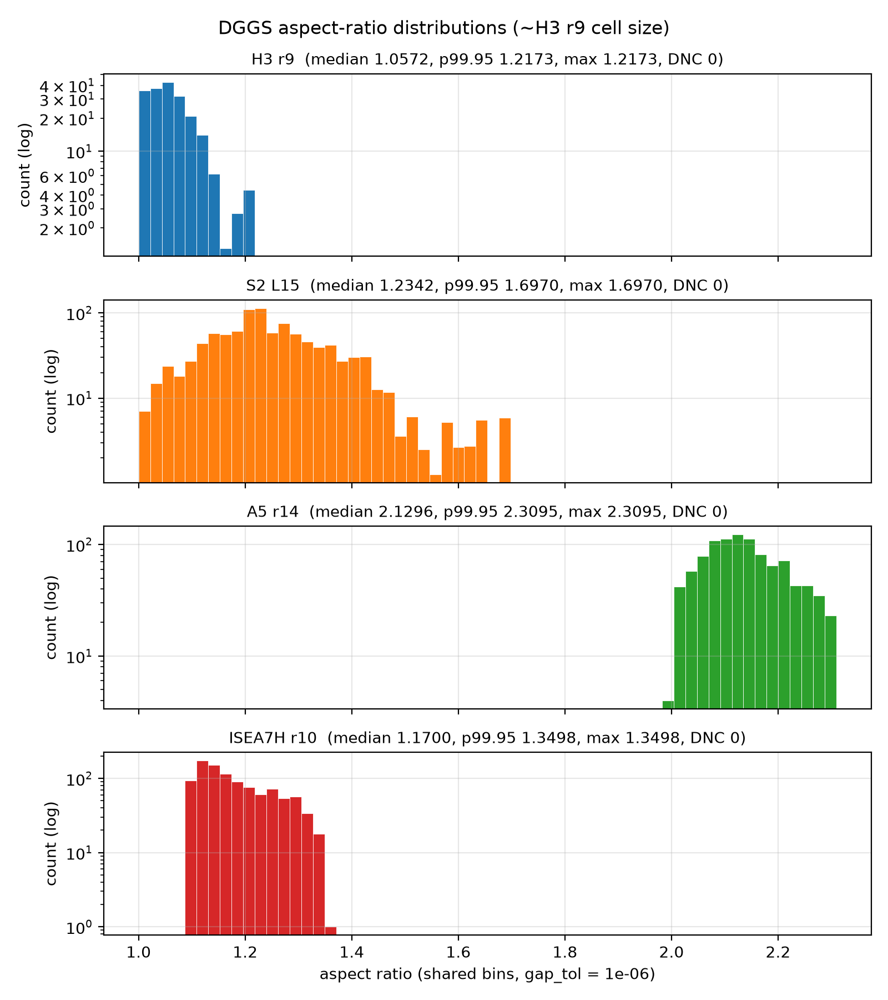
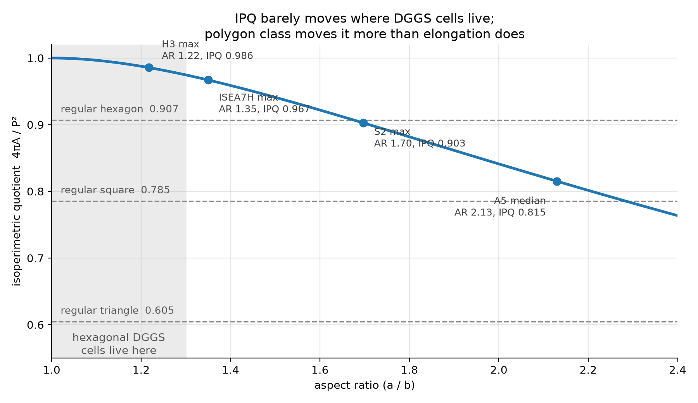

<!--
Time budget (25-minute slot; aim for ~21 minutes talking, the rest for
questions and slippage). Minute targets are in each section's speaker notes.

  1.0  title + about me
  2.0  problem: many DGGSs, area is the usual axis, shape is the other
  2.0  hook: round vs squished cells
  1.5  why squish matters
  4.0  definition + live demo
  2.0  convex, certified, the software
  5.0  survey: tradeoff, histograms, globes, table
  1.5  vs IPQ
  1.0  ellipsoid, the open question
  1.5  close + links
 21.5
-->

## About

- AJ Friend
- Waymo Product Data Science
- Past:
    - Uber Eats Data Science
    - `h3` and `h3-py` maintainer and steering committee member

Slides: [ajfriend.com/csar_talk](https://ajfriend.com/csar_talk)<br>
Code: [github.com/ajfriend/csar_py](https://github.com/ajfriend/csar_py)

<!-- TODO: confirm the slides URL once the Pages site exists -->

::: {.notes}
1 min, with the title slide. Same intro as the co-compaction talk.
:::

# The problem

## Many DGGSs. How do we compare them?

:::: {.columns}

::: {.column width="50%"}
- H3, S2, A5
- ISEA7H, IVEA7H, ISEA3H
- rHEALPix, HEALPix
- ...
:::

::: {.column width="50%"}
Things people measure:

- **area** variation
- hierarchy, aperture, indexing
- neighbor structure
- **shape**
:::

::::

::: {.notes}
2 min for this section. Everyone measures area. The equal-area systems win
that axis by construction. This talk is about the other axis.
:::

## Area is the axis everyone measures

{height="600"}

::: {.notes}
Area-matched resolutions, about H3 res 9 cell size. A5 and ISEA7H are a
single bar: equal-area by construction. H3 and S2 spread by a factor of
1.8 and 2. This is the usual story. Now the other axis.
:::

## Shape is the other axis

Same cell count, same area. Not the same shape.

- Some cells are visibly **wider in one direction** than the other
- Call it anisotropy, elongation, aspect ratio, or *squish*
- The usual metrics do not quite measure it (more on that later)

::: {.notes}
Transition to the hook: let me show you what I mean.
:::

# Some cells are squished

## H3, resolution 2: a round cell

```{=html}
<canvas class="r-stretch stage" data-cell="h3-low"></canvas>
```

::: {.notes}
2 min for the four cell slides. The ellipse through the vertices is the
thing we will define in a minute. Here it is nearly a circle: AR 1.00.
:::

## H3, resolution 2: a squished cell

```{=html}
<canvas class="r-stretch stage" data-cell="h3-high"></canvas>
```

::: {.notes}
Same system, same resolution, a different place on the globe: AR 1.23.
About a quarter wider one way than the other.
:::

## S2, level 3: a round cell

```{=html}
<canvas class="r-stretch stage" data-cell="s2-low"></canvas>
```

::: {.notes}
Cut this slide if short on time; the S2 squished cell carries the point.
:::

## S2, level 3: a squished cell

```{=html}
<canvas class="r-stretch stage" data-cell="s2-high" data-edit></canvas>
```

::: {.notes}
AR 1.55. A cube face corner. (This canvas is editable: you can drag a
vertex to show the ellipse respond, as a preview of the demo.)
:::

## Why squish matters

Anything that treats neighbors as equidistant is wrong by about the aspect ratio:

- **neighbor distances**: center-to-center spacing differs by direction
- **gradients and flows**: finite-difference stencils assume isotropy
- **convolution kernels**: a "circular" k-ring is an ellipse on the ground
- **aggregation**: a cell's footprint is a worse proxy for a disk

<!-- TODO figure: a k-ring on a round cell vs a squished cell, same resolution -->

::: {.notes}
1.5 min. Don't belabor it. One sentence per bullet. The point is that
shape is not cosmetic.
:::

# A spherical aspect ratio

## The idea

Given the vertices of a cell on the unit sphere:

1. Find the **tightest ellipsoidal cone** (apex at the sphere's center) that encloses them
2. Its cross-section is an ellipse; on the sphere it is the **rim** you saw drawn through the vertices
3. $\text{AR} = \dfrac{\text{major semi-axis}}{\text{minor semi-axis}} \ge 1$

AR 1 is a circular cap. Larger is more squished.

::: {.notes}
4 min for definition + demo. Why a cone and not an ellipse in some map
projection? Because the cone lives in 3D with the sphere and needs no
projection, no centroid, no tangent plane chosen by hand. The optimum
picks the axis.
:::

## Tightest Enclosing Ellipsoidal Cone

$$
\begin{array}{ll}
\underset{A,\, b}{\text{minimize}}
& -\logdet A \\
\text{subject to}
& \norm{A x_i}_2 \le b^\top x_i, \quad i = 1, \ldots, n \\
& \norm{b}_2 \le 1
\end{array}
$$

with

- data: $x_1, \ldots, x_n \in \R^3$ (on the sphere)
- variables: $A \in \Sym^3_{++}$ and $b \in \R^3$

::: {.notes}
One slide of math, for the people who want it. The cone is the set of x
with ||Ax|| <= b'x. Minimizing -log det A makes it as tight as possible.
Everyone else: it is "smallest cone that fits".
:::

## {#cone-demo background-interactive="true"}

```{=html}
<canvas id="cone" class="fullscreen" aria-label="Tightest enclosing ellipsoidal cone, interactive"></canvas>
<script type="module">
  import { mount } from './web/cellslide.js';
  mount(document.getElementById('cone'), {
    points: [[-20, 40], [-5, 48], [10, 50], [25, 46], [35, 38], [20, 30], [5, 28], [-10, 31]],
    view: { center: 'axis', dist: 2.7 },
    show: { sphere: true, hull: true },
  });
</script>
```

::: {.notes}
THE demo. Drag a point outward: the cone and the rim follow, AR goes up.
Drag it back in: a point inside the hull stops mattering. Shift-click adds
a point, double-click removes one. Every drag re-solves from scratch in
the browser in about 3 ms, with the real solver compiled to WebAssembly.
Budget 2 min here and no more.
:::

# How it is solved

## It is a convex problem

- **No local optima.** Any solution you find is *the* solution.
- **A certificate.** Duality gives a provable bound; the solver reports a duality gap with every answer, so "optimal" is checked, not asserted.
- **Declarative.** The problem statement is the spec, and checking a solution is easy. That leaves the solution *strategy* free to change, which is a great regime for working with coding agents: they can try strategies, and the certificate tells you if they are right.

::: {.notes}
2 min for this section, 1 min on this slide. The agents point is one
sentence out loud, not a tangent.
:::

## The software

- `csar`: the solver, written in Zig, with a C ABI
- `pip install csar`: wheels for CPython 3.11 to 3.14, Linux, macOS, Windows
- Also compiled to **WebAssembly**: the demo you just saw was the real solver
- Fast enough to survey **millions of cells** per run, each with a certificate
- Open source, MIT

<!-- TODO: one line with the native per-cell timing from csar_zig/bench -->

::: {.notes}
Point back at the demo. Microseconds per cell natively; the whole survey
that follows is a few million solves.
:::

# The survey

## Shape versus area, at matched resolution

{height="560"}

::: {.notes}
5 min for the survey. This is the one picture. Ideal grid is the star.
Equal-area systems sit on the floor, but pay in shape: ISEA7H a little,
A5 a lot (its cells are never round, AR about 2). H3 and S2 trade the
other way: better shape, worse area. Nobody is at the star. Nobody can
be: you cannot tile a sphere with identical round cells.
:::

## Aspect-ratio distributions

{height="620"}

::: {.notes}
Log counts. H3 is tight, 1.00 to 1.22. S2 stretches to 1.70 at cube
corners. A5 is a narrow band around 2.1. ISEA7H 1.09 to 1.35, the
projection's distortion field. AR is nearly resolution-independent for
small cells, so these shapes persist at every finer level.
:::

## {background-iframe="https://ajfriend.com/dggs_compare/#globes" background-interactive="true" menu-title="Where on the globe? (live)"}

<!-- TODO: dggs_compare needs an ?embed mode (globes grid only, no page header) so the slide shows the globes above the fold. Until then scroll inside the iframe. -->

::: {.notes}
Live site, one globe per system, colored by AR. Spin H3: the bands of
squish follow the icosahedron edges. S2: cube corners. ISEA7H: a six-
pointed star on every face. If the wifi is bad, skip to the next slide.
:::

## Where on the globe? (fallback)

<!-- TODO: screenshot of the globes tab at ajfriend.com/dggs_compare for projector/wifi trouble -->

*Screenshot placeholder. Hidden from the normal flow once the screenshot exists.*

## Summary, at about H3 res 9 cell size

| system | median AR | max AR | area max/min |
|---|---:|---:|---:|
| H3 r9 | 1.06 | 1.22 | 1.80 |
| S2 L15 | 1.23 | 1.70 | 2.01 |
| A5 r14 | 2.13 | 2.31 | 1.00 |
| ISEA7H r10 | 1.17 | 1.35 | 1.00 |

<!-- TODO: add IVEA7H r10 and rHEALPix r9 rows from the dggs_compare site -->

More systems, every resolution, and the data: [ajfriend.com/dggs_compare](https://ajfriend.com/dggs_compare/)

::: {.notes}
The tradeoff in numbers. Then: "but wait, isn't there already a shape
metric?"
:::

# Aspect ratio versus IPQ

## IPQ measures something else

{height="520"}

::: {.notes}
1.5 min. The isoperimetric quotient, 4 pi A over P squared, is the
field's shape metric. For a pure ellipse it moves under 3% across the
whole band where hexagonal DGGS cells live, less than a quarter of the
hexagon-to-square gap. Polygon class dominates it; elongation is noise
in it. IPQ does see boundary roughness, which AR ignores. Companions,
not competitors: IPQ for roundness-of-boundary, AR for elongation.
:::

# What about the ellipsoid?

## The sphere is the honest place to define it

- Everything so far is on the sphere: the metric is exact, the only error is floating point
- Real grids live on WGS84 (some of them)
- Gauss says: **no map from ellipsoid to sphere is both conformal and equal-area** on any patch
- So area and shape need *different* auxiliary spheres: authalic latitude for area, conformal latitude for shape
- The difference is small: shape changes by at most ~0.2% between the two
- Which surface your "shape" lives on is a modeling choice. I am leaving it open.

::: {.notes}
1 min. Don't get drawn into the debate. The theorem is the content; the
rest is a choice the user makes, and csar is fine with either sphere.
:::

# Closing

## Area is not the only design constraint

- Equal area is a fine goal. It is **one** goal.
- Shape, hierarchy, indexing, neighbor structure, ease of implementation...
- Every DGGS picks a point in that space. There is no free lunch on a sphere.
- Aspect ratio is one axis of that space. Now it is **cheap and exact** to measure.

::: {.notes}
1.5 min with the links slide. The message: use the tool to see the
tradeoff you are already making.
:::

## Thanks

- `pip install csar` · [github.com/ajfriend/csar_py](https://github.com/ajfriend/csar_py)
- Solver: [github.com/ajfriend/csar_zig](https://github.com/ajfriend/csar_zig)
- Survey and globes: [ajfriend.com/dggs_compare](https://ajfriend.com/dggs_compare/)
- The demo: [ajfriend.com/csar_viz](https://ajfriend.com/csar_viz/)
- Paper in preparation
- These slides: <!-- TODO: Pages URL -->
