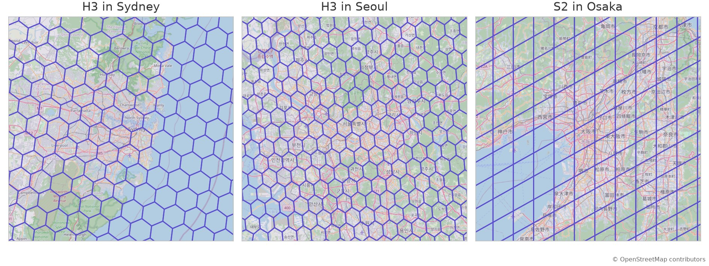
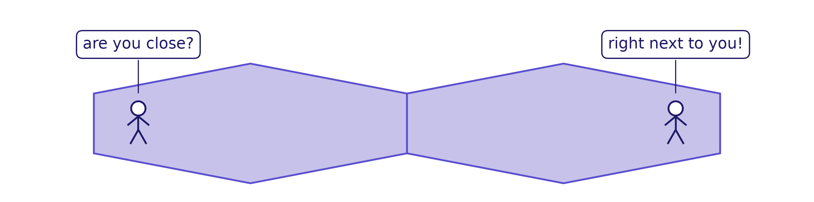
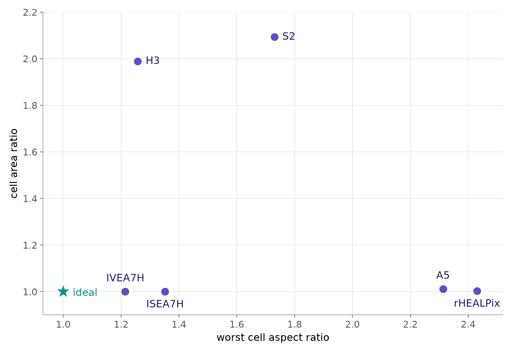

## About

- AJ Friend
- Waymo Product Data Science
- Past:
    - Uber Eats Data Science
    - `h3` and `h3-py` maintainer and steering committee member

Slides: [ajfriend.com/csar_talk](https://ajfriend.com/csar_talk)<br>
Code: [github.com/ajfriend/csar_py](https://github.com/ajfriend/csar_py)

::: {.notes}
1 min, with the title slide. Same intro as the co-compaction talk.

Time budget (25-minute slot; aim for ~21 minutes talking). The live
budget is the table in beats.md; per-section targets are in each
section's notes.
:::

## How *squished* are these cells?

<!-- figure: scripts/make_city_grids.py (basemap glue: scripts/_basemap.py);
     cities chosen by scripts/score_cities.py. Same true ground extent in
     every panel; OSM tiles, Web Mercator. -->
{width="100%"}

::: {style="font-size: 0.8em"}
H3 grid in two locations. S2 cells are stretched in one direction.\*
:::

::: {.fine}
\* Web Mercator. At city scale, cell shape matches the sphere: the distortion comes from the grid, not the projection.
:::

::: {.notes}
Sydney, Seoul, Osaka. The first two are the same system at the same
resolution; the only difference is where on the globe. Something is up,
and the question is how much. If asked "isn't that the map projection?":
web map tiles are Web Mercator, which is conformal, so at city scale every
shape on screen is true to the sphere. The squish is the grid's. And the
metric we get to never projects anything at all.
:::

## Sphere-native

That's the last time we'll mention a planar projection.

- rest of the talk: on the sphere, natively
  - no projection distortion, no center to choose
- grids defined on WGS84 ellipsoid: map to sphere first
  - for shape, difference is small; discussion at end
- math is cleaner

::: {.notes}
Half a minute. The one modeling decision, stated once, and the last
time this talk mentions a projection. Grids defined on WGS84 are mapped
to the sphere by an auxiliary latitude before measuring (authalic, which
keeps the equal-area grids exactly equal-area). The sphere-vs-WGS84
effect, measured on 400k cells (dggs_compare #89): AR changes by at most
0.22% (worst at the equator), area by a 0.67% spread. No grid is anywhere
near conformal (best worst-case AR ~1.21), so 0.22% is invisible against
every grid's own stretch. Cells are spherical polygons with great-circle
edges, and both metrics are computed on that object with no projection
anywhere.
:::

## Why shape/squish/stretch matters

- a cell represents all the points inside it
- points in a cell should be (relatively) close together
- stretched cell: points farther apart in some direction

<!-- figure: scripts/make_neighbors.py -->
{width="100%"}

::: {.fine}
See Kimerling, Sahr, White & Song (1999), *Comparing geometrical properties of global grids*, criterion 5
:::

::: {.notes}
Under a minute. "Close together" is Tobler's first law (near things are more
related than distant things), which is what Kimerling invokes; say the name
if the room wants it. The field's own argument for compact cells, from the
founding paper of the equal-area tradition (Sahr wrote DGGRID and ISEA3H),
and it is really an argument about distance within a cell, which is
exactly what stretch violates. Original: "Because a single vector of
values will be associated with all the points in a single areal cell, it
is preferable that the actual values of all the points in the cell be as
much alike as possible. Maximal compactness ensures that the points in a
cell are as close to each other as possible, thus taking advantage of
Tobler's first law of geography." (p. 273)
:::

## Two ways to measure shape {.smaller}

1. **isoperimetric quotient (IPQ)**
   - $\text{IPQ} = \left( \dfrac{\text{perimeter of the circle with the same area}}{\text{perimeter of the shape}} \right)^2$
   - "how close is this polygon to a circle?"
   - $\text{IPQ} \le 1$
2. **conic spherical aspect ratio (CSAR)**
   - "how stretched is this shape?"
   - this talk; definition later, but **will match your intuition**
   - $\text{CSAR} \ge 1$

::: {.notes}
Under a minute. Two ways to put a number on shape. Compactness is what the
field uses (Kimerling 1999, Kmoch 2022). In symbols, IPQ = A(4π−A)/P² with
A the spherical area and P the perimeter: on the unit sphere a cap of
area A has perimeter² = A(4π−A) (the isoperimetric identity; 4π−A is the
complementary cap's area), so IPQ is the squared ratio of that cap's
perimeter to the shape's: the form the sphere's isoperimetric inequality
P² ≥ A(4π−A) gives, and exactly what Kimerling's ZSC is the square root of
(zone perimeter over cell perimeter). The planar 4πA/P² is its small-cell
limit; in the plane the area-ratio and perimeter-ratio definitions agree,
on the sphere they split and this is the perimeter one. Practical implementations
usually compute the planar one after projecting each cell. Aspect
ratio is the one this talk defines: how stretched. The next slides are
drawn flat because at cell scale the sphere is flat to one part in a
million, but every number on them is computed on the sphere.
:::

<!-- Four live slides: the shapes are drawn ON the sphere by the same
     library as the demo slide (points + numbers from scripts/make_stretch.py
     via slides/data/shapes.js; captions filled in by web/cellslide.js).
     data-dist on the .pair: one camera distance for every shape, so a 1.5x
     stretch looks 1.5x wider. The whole sphere fits the canvas only for
     dist >= ~2.51 (teec draws it 2*1.15/sqrt(dist^2-1) of the short side),
     so 2.4 clips the poles. -->

## Is IPQ enough? {#ipq-square}

```{=html}
<div class="pair" data-dist="2.7">
  <div><canvas class="stage" data-cell="square" data-show="hull" data-nums></canvas></div>
  <div><canvas class="stage" data-cell="square_stretched" data-show="hull" data-nums></canvas></div>
</div>
```

::: {.point}
A spherical square has CSAR 1.0. Stretch by 1.5x and CSAR matches.<br>
CSAR is *natural*.
:::

::: {.notes}
About 1.5 min for the four slides. A 3:2 rectangle is what everyone already
calls "aspect ratio 1.5". Compactness moved a little, in the right
direction, to a number nobody could have predicted. Both shapes are a few
degrees across, on the sphere, with their enclosing ellipses solved live.
:::

## Is IPQ enough? {#ipq-class}

```{=html}
<div class="pair" data-dist="2.7">
  <div><canvas class="stage" data-cell="square" data-show="hull" data-nums></canvas></div>
  <div><canvas class="stage" data-cell="hexagon" data-show="hull" data-nums></canvas></div>
</div>
```

::: {.point}
Two *regular* shapes: different IPQ, same CSAR.<br>
IPQ responds to boundary and stretch. CSAR only measures stretch.
:::

::: {.notes}
A square and a hexagon, both as round as their polygon class allows.
Compactness separates them by 0.11 before anything is distorted. Aspect
ratio says 1 for both: nothing to undo. Comparing H3 to S2 on compactness
is mostly comparing hexagons to squares.
:::

## Is IPQ enough? {#ipq-hexagon}

```{=html}
<div class="pair" data-dist="2.7">
  <div><canvas class="stage" data-cell="hexagon" data-show="hull" data-nums></canvas></div>
  <div><canvas class="stage" data-cell="hexagon_stretched" data-show="hull" data-nums></canvas></div>
</div>
```

::: {.point}
Stretch regular hexagon by 1.5x.<br>
IPQ depends on the shape you started with. CSAR measures the stretch.
:::

::: {.notes}
A stretched hexagon still out-scores a perfect square on compactness
(the numbers are on screen): polygon class moves it more than the stretch
does. Say this
verbatim: "IPQ is a good measure of what it measures. Within one DGGS every
cell is about equally smooth, so stretch is what varies, and that's what
this isolates."

If asked about Kimerling's numbers: his ZSC is the square root of IPQ, which
halves every change here; same conclusion. If asked "stretched how?": a
stretch of the gnomonic coordinates, the one stretch that maps cones to
cones, so AR scales by exactly the factor at any size (checked to 50°).
:::

## Is IPQ enough? {#ipq-star}

:::: {.r-hstack}

::: {style="width: 50%"}
```{=html}
<div class="pair" data-dist="2.7">
  <div><canvas class="stage" data-cell="star" data-show="outline" data-nums></canvas></div>
</div>
```
:::

::: {.point style="width: 50%"}
- IPQ and CSAR are **complementary**
- IPQ measures boundary roughness and stretch
- CSAR isolates stretch
:::

::::

::: {.notes}
The foil in the other direction: by symmetry its enclosing ellipse is a
circle, so AR is 1; its perimeter is enormous, so IPQ collapses. Two
instruments, two questions. This talk is about the second one.
:::

# CSAR: Conic spherical aspect ratio

## {#conic-spherical-aspect-ratio menu-title="CSAR, defined"}

:::: {.r-hstack}

::: {style="width: 58%"}
```{=html}
<div class="pair tall"><div>
<canvas id="cone" class="stage" aria-label="Tightest enclosing ellipsoidal cone, interactive"></canvas>
<p class="nums" id="cone-nums"></p>
</div></div>
<script type="module">
  import { mount } from './web/cellslide.js';
  const nums = document.getElementById('cone-nums');
  mount(document.getElementById('cone'), {
    points: [[-20, 40], [-5, 48], [10, 50], [25, 46], [35, 38], [20, 30], [5, 28], [-10, 31]],
    view: { center: 'axis', dist: 2.7 },
    show: { sphere: true, hull: true, axes: true, axis: false },
    onSolve: sol => { nums.textContent = sol.ok ? `CSAR ${sol.aspect.toFixed(2)}` : ''; },
  });
</script>
```
:::

::: {.point style="width: 42%"}
<h2>Conic spherical aspect ratio</h2>

- **input**: polygon vertices, on the sphere
- find "smallest" *ellipsoidal cone* with tip at origin that contains them
- **CSAR**: ratio of axes of cross-sectional ellipse ($\geq 1$)
:::

::::

::: {.notes}
4 min for definition + demo + math. THE demo, on the left. Drag a point
outward: the cone and the rim follow, CSAR goes up. Drag it back in: a
point inside the hull stops mattering, only the points on the rim are
active. Shift-click adds a point, double-click removes one. Every drag
re-solves from scratch in the browser in about 3 ms, with the real solver
compiled to WebAssembly.

Why a cone and not an ellipse in some map projection? Because the cone
lives in 3D with the sphere and needs no projection, no centroid, no
tangent plane chosen by hand. The optimum picks the axis. Properties
worth saying out loud: input is corner points only; no projection, no
center to choose; works everywhere (a cell at the pole or straddling 180°
is just points on a sphere; any per-cell projection pipeline has to
special-case those seams, this never meets them: say it as a feature,
not a critique); one answer, convex, so unique, with a certificate;
scale-free, a proportion, not a size.
:::

## Finding the "smallest" ellipsoidal cone {.smaller}

:::: {.r-hstack}

::: {style="width: 50%"}
$$
\begin{array}{ll}
\underset{A,\, b}{\text{minimize}}
& -\logdet A \\
\text{subject to}
& \norm{A x_i}_2 \le b^\top x_i \\
& \norm{b}_2 \le 1
\end{array}
$$

- data: $x_1, \ldots, x_n \in \R^3$, on the sphere
:::

::: {style="width: 47%"}
- **convex optimization** problem
  - efficiently solvable
  - no local optima to get stuck in
  - duality certificates of optimality
  - related to *minimum volume enclosing ellipsoid* (MVEE)
- software
  - `pip install csar`
  - [github.com/ajfriend/csar_py](https://github.com/ajfriend/csar_py)
  - [github.com/ajfriend/csar_zig](https://github.com/ajfriend/csar_zig)
:::

::::

::: {.notes}
1.5 min. The cone is the set of x with ||Ax|| <= b'x; minimizing
-log det A makes it as tight as possible. For the people who know the
form: it is a convex problem, so any solution you find is the solution,
and duality gives a provable bound; the solver reports a duality gap with
every answer, so "optimal" is checked, not asserted. One spoken sentence
if the room is technical: the problem statement is the spec and checking
a solution is easy, which leaves the solution strategy free to change, a
good regime for working with coding agents. Everyone else: "smallest cone
that fits, and the computer can prove it found it".

Software: the solver is written in Zig with a C ABI; pip installs wheels
for CPython 3.11 to 3.14 on Linux, macOS, and Windows; the same solver
compiled to WebAssembly ran the demo you just dragged. Fast enough that
the survey that follows is a few million solves, each with a certificate.
Open source, MIT.
:::

# Comparing grids

## {#h3-globe menu-title="H3 globe"}

<div class="globe-wrap"><canvas data-globe="h3_r3"></canvas></div>

::: {.notes}
3.5 min for the globes. Section opener, spoken: everyone measures area,
and the equal-area systems win that axis by construction; this is the
other axis. Every H3 cell at resolution 3, colored by
aspect ratio on a scale shared by all the globes that follow. The
stretch follows the icosahedron edges: H3 is round mid-face and
stretched where the gnomonic faces meet. Drag it. Then hit the area
toggle: the warm colors are the other field, and it is not the same
picture. Area peaks mid-face, stretch peaks at the edges. Two axes.
Hover a cell for both numbers; click one and the solver draws its
ellipse live.
:::

## {#s2-globe menu-title="S2 globe"}

<div class="globe-wrap"><canvas data-globe="s2_r6"></canvas></div>

::: {.notes}
S2 at level 6: the cube. Round at face centres, stretched to 1.7 at
the cube corners (Osaka from the opening slide sits near one).
:::

## {#isea7h-globe menu-title="ISEA7H globe"}

<div class="globe-wrap"><canvas data-globe="isea7h_r4"></canvas></div>

::: {.notes}
ISEA7H, equal-area by construction. The price: a six-pointed star of
stretch on every icosahedron face, max 1.3. The pentagons are the
small dark spots at the vertices.
:::

## {#ivea7h-globe menu-title="IVEA7H globe"}

<div class="globe-wrap"><canvas data-globe="ivea7h_r4"></canvas></div>

::: {.notes}
Same grid, different projection: IVEA replaces ISEA's equal-area
projection with one whose distortion is spread smoothly instead of
concentrated at the face edges. The six-pointed stars are gone; the
stretch is a smooth pinwheel on each face, and the worst cell is better.
Still exactly equal-area. This is the kind of design change the metric is
for: you can see what the new projection bought.
:::

## {#a5-globe menu-title="A5 globe"}

<div class="globe-wrap"><canvas data-globe="a5_r6"></canvas></div>

::: {.notes}
A5, also equal-area. Its cells are never round: the whole globe sits
at about 2. The scale tops out at 2.38, rHEALPix's worst, next slide. Equal area was bought
with shape, uniformly.
:::

## {#rhealpix-globe menu-title="rHEALPix globe"}

<div class="globe-wrap"><canvas data-globe="rhealpix_r4"></canvas></div>

::: {.notes}
A different construction. rHEALPix is equal-area and square, built from a cube with
the two polar faces folded in. Mid-latitudes are nearly round. The polar
caps are where it pays: cells stretch toward the cap corners and the worst
cell is 2.38, the most stretched of any system here, on a few cells. Most
of the globe is fine, so the median is 1.18 and the extreme is in the
tail. This is the case the "max or weighted?" open question is about.
:::

## DGGS trade-off: shape vs. area

<!-- figure: scripts/make_tradeoff.py, computed from the survey tables at
     the working resolutions listed beside it, the six systems of the globes -->

:::: {.r-hstack}

::: {style="width: 72%"}
{width="100%"}
:::

::: {.fine style="width: 24%"}
resolutions

- H3: 9
- S2: 15
- ISEA7H: 10
- IVEA7H: 10
- A5: 14
- rHEALPix: 9

exhaustive analysis: [ajfriend.com/dggs_compare](https://ajfriend.com/dggs_compare/)
:::

::::

::: {.notes}
1.5 min, and this is the close. The one picture: the six globes as six
points. The ideal grid is the star. The equal-area systems sit on the
floor and pay in shape, from ISEA7H's little to A5's and rHEALPix's
about 2.4 (rHEALPix only at the polar caps, median 1.18: the "max or
weighted?" open question). H3 and S2 trade the other way: better shape,
worse area. Nobody is at the star, and nobody can be: you cannot tile a
sphere with identical round cells.

The message, spoken, not on a slide: equal area is a fine goal, and it is
one goal. Shape, hierarchy, indexing, neighbours, ease of implementation.
Every DGGS picks a point in that space. Aspect ratio is one axis of it,
and now it is cheap and exact to measure. Use it to see the trade-off you
are already making.
:::

## Open questions

- **sphere vs. ellipsoid**
  - how to fairly compare systems defined on different surfaces?
  - authalic or conformal mapping to the sphere?
  - does CSAR even apply to ellipsoidal systems?
- **extreme cells**
  - pentagons, cube corners
  - worst case or quantiles?

::: {.notes}
1 min. This is a work in progress and these are the questions I'd like
help with. Sphere vs ellipsoid: measured on 400k cells, moving between
authalic and conformal spheres changes AR by at most 0.22% and area by a
0.67% spread; authalic keeps the equal-area grids exactly equal-area, so
that's what the survey uses, but it is a choice. Extreme cells: H3 and
ISEA have 12 pentagons, S2 has 8 cube corners, rHEALPix has polar caps;
dggs_compare reports median, p99.95, and max side by side so you can see
both the typical cell and the worst one. Resolution matching: the survey
matches mean cell area (the resolutions on the trade-off slide). Sampling:
coarse levels are enumerated in full, fine ones are 1M point-drawn cells,
which are size-biased unless weighted by 1/area, and the published plots
are. Direction: the enclosing cone gives the axis for free; the AR globes
show magnitude only. All of it is on the site, with the data as Parquet.
:::

## Questions?

:::: {.r-hstack style="margin-top: 3em"}

::: {.links style="width: 60%"}
code
:   [github.com/ajfriend/csar_py](https://github.com/ajfriend/csar_py)<br>
    [github.com/ajfriend/csar_zig](https://github.com/ajfriend/csar_zig)

viz
:   [ajfriend.com/dggs_compare](https://ajfriend.com/dggs_compare/)<br>
    [ajfriend.com/csar_viz](https://ajfriend.com/csar_viz/)

slides
:   [ajfriend.com/csar_talk](https://ajfriend.com/csar_talk/)
:::

::: {.point style="width: 36%"}
Thanks to Kevin Sahr and Ben Griffin for helpful discussions.
:::

::::
